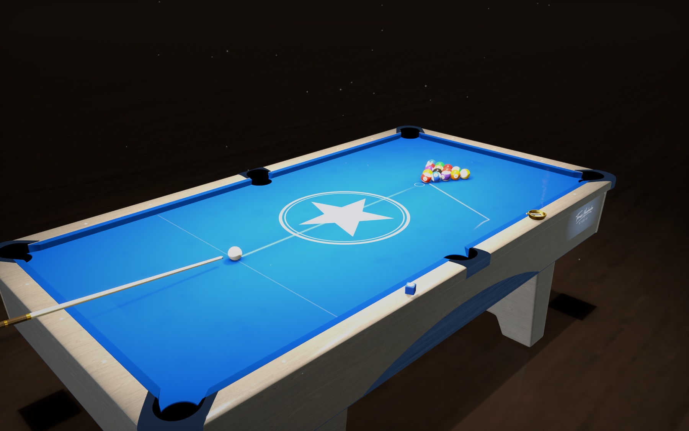
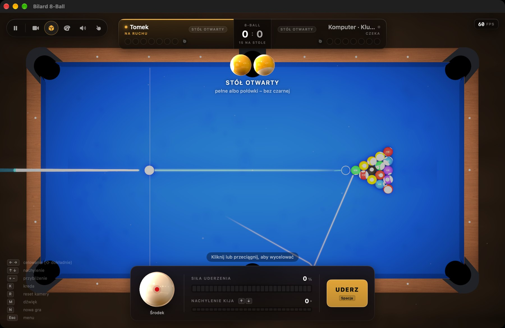
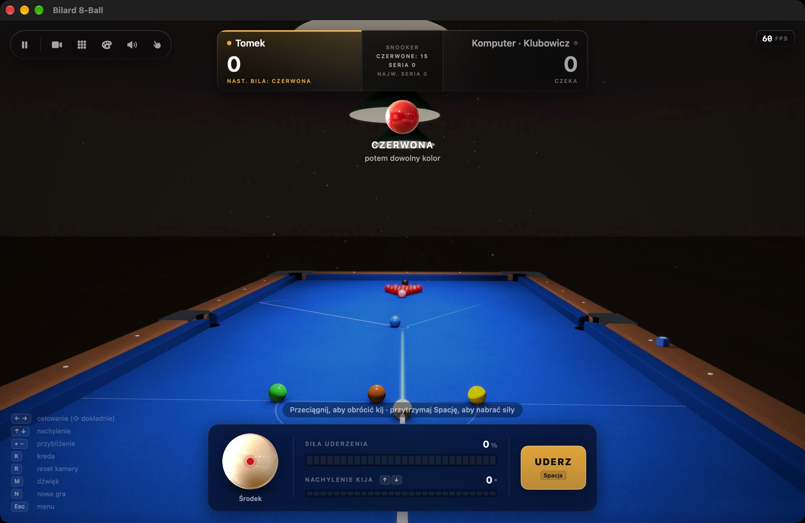
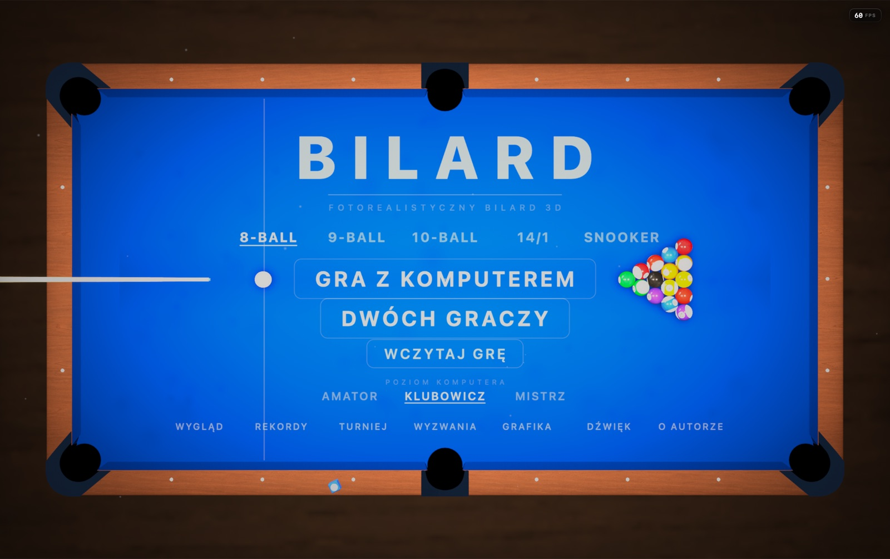
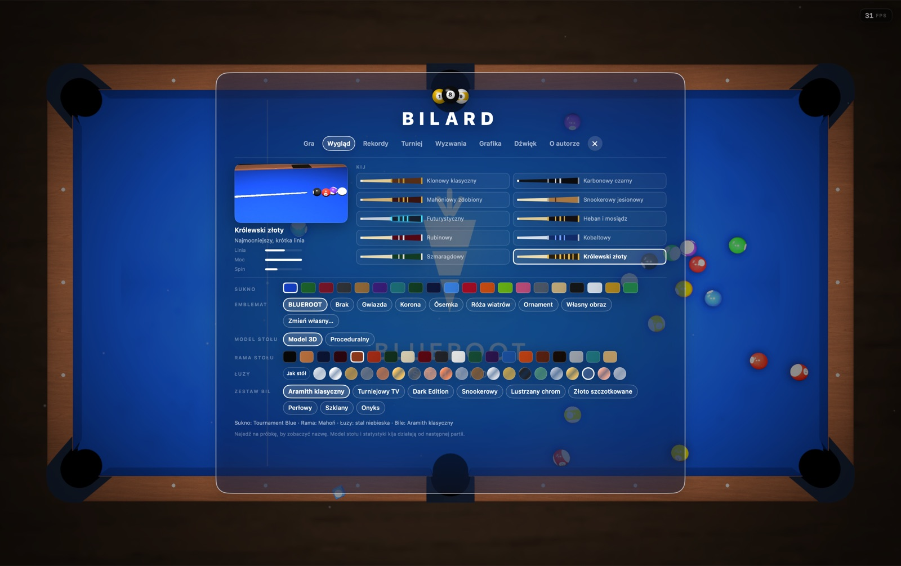
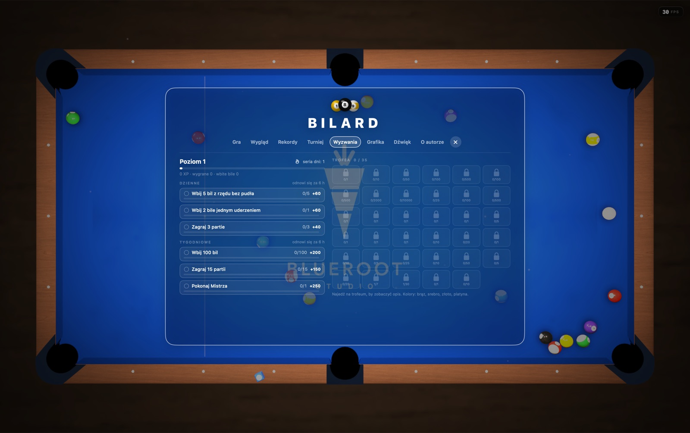
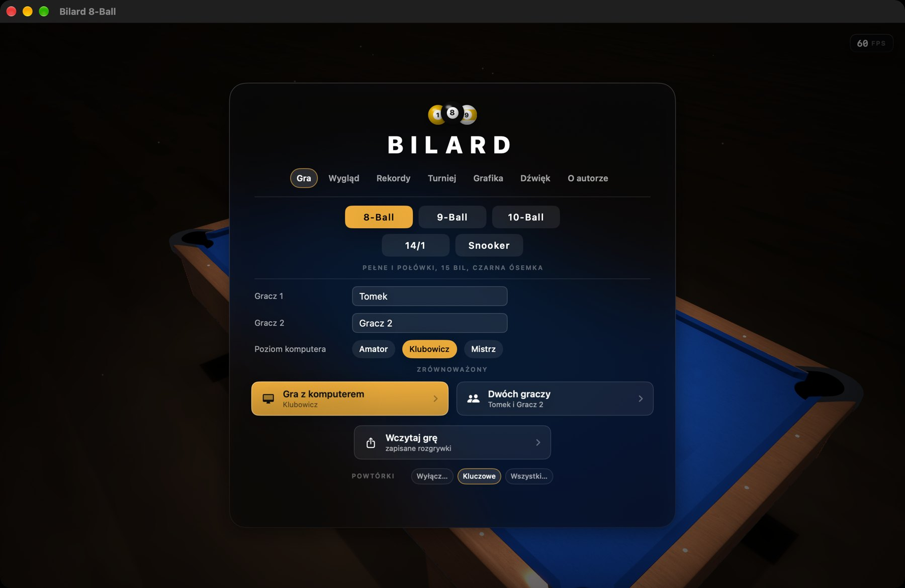

> ⬇️ **[Pobierz / Download Bilard (DMG)](https://github.com/Carrot79PL/Bilard/releases/latest)** · macOS 14+, Apple Silicon · darmowa / free · pierwsze uruchomienie: prawy przycisk → Otwórz

# Bilard 8-Ball

Natywna gra bilardowa 3D na macOS: **ósemka, dziewiątka, dziesiątka, 14/1 i snooker**, z własną fizyką bil, przeciwnikiem komputerowym na trzech poziomach, trybem turniejowym i fotorealistyczną grafiką. Napisana w Swift, SceneKit (Metal) i SwiftUI, bez silnika gier.
🇬🇧 *A native 3D pool game for macOS: 8-ball, 9-ball, 10-ball, straight pool (14.1) and snooker, with custom ball physics, three AI levels, a tournament mode and photoreal graphics. Pure Swift, SceneKit (Metal) and SwiftUI — no game engine.*

**Wersja:** 1.1  ·  **Autor:** Tomasz Marchewka



| Widok z góry i deklaracje zagrań | Snooker (stół 12 stóp) |
|---|---|
|  |  |



| Personalizacja (20 sukien, ram i łuz, 10 kijów) | Wyzwania i trofea |
|---|---|
|  |  |



## Nowości w wersji 1.1

- **Menu na suknie:** po uruchomieniu widać stół z góry i demo AI vs AI, a menu jest białym nadrukiem na suknie (bile toczą się po napisach). Stare menu zostaje do wyboru w Grafika → „Menu główne”.
- **Emblemat na suknie:** logo BLUEROOT (domyślnie), gwiazda, korona, ósemka, róża wiatrów, ornament, brak albo własny obraz.
- **Więcej materiałów:** po 20 rodzajów sukna, ramy stołu i okuć łuz oraz 10 kijów z ozdobnymi pierścieniami; zakładka Wygląd bez przewijania.
- **Wyzwania i trofea:** 3 dzienne i 3 tygodniowe wyzwania, 35 trofeów (brąz, srebro, złoto, platyna), poziomy XP, seria dni i powiadomienia.
- **Po wygranej:** konfetti opadające na stół i syntezowane brawa z okrzykami.
- **HDR:** opcja wyjścia HDR (EDR) na ekranach, które ją obsługują.
- **Poprawki:** mniejsze i lepiej ustawione łuzy stołu z modelu 3D, płynne przejście podłogi w horyzont, przezroczyste menu pauzy.

## Tryby gry

| Tryb | Zasady w skrócie |
|---|---|
| **8-Ball** | 15 bil: pełne i połówki, czarna ósemka na koniec, otwarty stół po rozbiciu, „biała w ręce” po faulu. |
| **9-Ball** | Bile 1–9 w rombie, zawsze trzeba trafić najniższą bilę na stole, wygrywa wbicie dziewiątki (także z kombinacji). |
| **10-Ball** | Jak dziewiątka, ale z **deklarowaniem zagrań** (bila i łuza przed strzałem). Wbicia niezadeklarowane nie liczą się. |
| **14/1 (Straight Pool)** | Gra do 50 lub 100 punktów, punkt za każdą zadeklarowaną i wbitą bilę, automatyczne ustawianie nowego trójkąta. |
| **Snooker** | Większy stół (12 stóp), mniejsze bile, 15 czerwonych i 6 kolorów, czerwona → kolor → kolory po kolei. |
| **Turniej** | Drabinka z profilami graczy. |

Każdy tryb można rozegrać z komputerem (**Amator, Klubowicz, Mistrz**) albo we dwie osoby przy jednym Macu. Imiona graczy są zapamiętywane. Jest zapis gry (3 sloty), powtórki zagrań w zwolnionym tempie, ocena strzałów i tablica rekordów dla każdego trybu.

## Fizyka

- Własny silnik w stałym kroku czasowym (wysoka częstotliwość), bez tunelowania przy szybkich uderzeniach.
- Sprężystość bila–bila ≈ 0,95 i bila–banda ≈ 0,75, tarcie ślizgowe i toczne sukna, opór powietrza.
- Pełna rotacja bil: top-spin, back-spin i gwint boczny (punkt uderzenia wybierany na białej bili), nachylenie kija (masse).
- Bandy K-66, łuzy z kolankami, przekaz rotacji przy zderzeniach.

## Grafika i dźwięk

- Renderowanie przez **Metal** (SceneKit), 4K i Retina, MSAA, HDR, bloom, miękkie cienie, odbicia środowiskowe.
- Materiały PBR ze skanów (sukno snookerowe, orzech, skóra) i oświetlenie z HDRI sali bilardowej. Polerowane bile z lakierem (clearcoat), chromowane okucia łuz.
- **Personalizacja z podglądem 3D:** 5 kijów (różne statystyki), 5 rodzajów sukna, zestawy bil (klasyczne, turniejowe TV, ciemne, snookerowe i inne) oraz wykończenia stołu.
- **Ustawienia grafiki:** presety Niska / Średnia / Wysoka / Ultra, rozdzielczość tekstur, cienie, odbicia, efekty, limit klatek (60 / 120).
- Kamera z kilkoma ustawieniami (TV, zza łuzy, swobodna), widok z góry i najazd na bilę decydującą.
- Dźwięk 3D syntezowany w kodzie (trzask bil, banda, kapka kija, łuza) oraz muzyka proceduralna (lofi, jazz, ambient) z osobnymi suwakami muzyki, efektów i otoczenia.

## Sterowanie

| Gdzie | Klawisze i mysz |
|---|---|
| Celowanie | przeciągnięcie myszą – obrót, **← →** – precyzyjne celowanie (Shift – drobniej), **↑ ↓** – nachylenie kija, **+ −** / scroll – zbliżenie |
| Uderzenie | **Spacja** (przytrzymaj = siła, puść = uderzenie), prawy przycisk myszy w dół i puść, przycisk **UDERZ** |
| Rotacja bili | okrąg w panelu – punkt uderzenia (top, back, boczna) |
| Widok | **C** – widok z góry, **V** – następna kamera, **R** – reset kamery |
| Inne | **K** – kreda, **P** – ustaw białą bilę, **M** – dźwięk, **N** – nowa gra, **Esc** – menu |

## Uruchomienie ze źródeł

Wymagania: macOS 14 lub nowszy, Mac z procesorem Apple Silicon i Xcode Command Line Tools (`xcode-select --install`).

```bash
./build.sh
```

```bash
open Bilard.app
```

Skrypt kompiluje źródła przez `swiftc` (bez projektu Xcode), generuje ikonę i podpisuje aplikację lokalnie (ad hoc). Zapis gier, ustawień i rekordów leży w `~/Library/Application Support/`.

Aby użyć Xcode: utwórz projekt macOS App, dodaj wszystkie pliki `.swift` (plik `main.swift` jest punktem wejścia), skopiuj do zasobów `Resources/` i `Assets/`, dodaj frameworki Cocoa, SceneKit, SpriteKit, AVFoundation, SwiftUI, Metal i QuartzCore (cel: macOS 14, arm64).

## Struktura kodu

| Plik | Zawartość |
|---|---|
| `BilliardPhysics.swift` | fizyka bil, bandy, łuzy, uderzenie kijem |
| `GameStateManager.swift` | zasady wszystkich trybów (`GameModeRules`), model HUD, przeciwnik komputerowy |
| `GameSceneController.swift` | pętla gry, kamery, celowanie, efekty |
| `TableBuilder.swift`, `TextureFactory.swift`, `Textures.swift` | stół, bile, kij, światła, materiały i tekstury |
| `CameraDirector.swift`, `TVCamera.swift`, `ReplayRecorder.swift`, `ShotEvaluator.swift` | kamery, powtórki, ocena zagrań |
| `HUDView.swift`, `MenuViews.swift`, `Settings.swift`, `Personalize.swift`, `Tournament*.swift`, `SaveGame.swift` | interfejs, ustawienia, personalizacja, turniej, zapis |
| `AudioEngine.swift`, `MusicEngine.swift` | dźwięk 3D, muzyka i brawa |
| `ClothMenu.swift`, `Emblems.swift`, `Confetti.swift`, `Challenges.swift`, `HDRSupport.swift` | menu na suknie, emblematy, konfetti, wyzwania i trofea, HDR |
| `Resources/Shaders.metal` | shadery (modyfikatory SceneKit) |

## Podziękowania i licencje zasobów

- Tekstury **orzech (American walnut veneer)**, **brązowa skóra** i HDRI **billiard hall** — [Poly Haven](https://polyhaven.com) (CC0).
- Tekstura **sukna snookerowego** (Fabrics 0075) — [TextureCan](https://www.texturecan.com).
- Model 3D stołu bilardowego (`Assets/table_model`) — zasób firm trzecich dostarczony przez autora gry; informacja o źródle i licencji zostanie uzupełniona.
- Kod gry © Tomasz Marchewka. Wszystkie prawa zastrzeżone, o ile nie zaznaczono inaczej.
